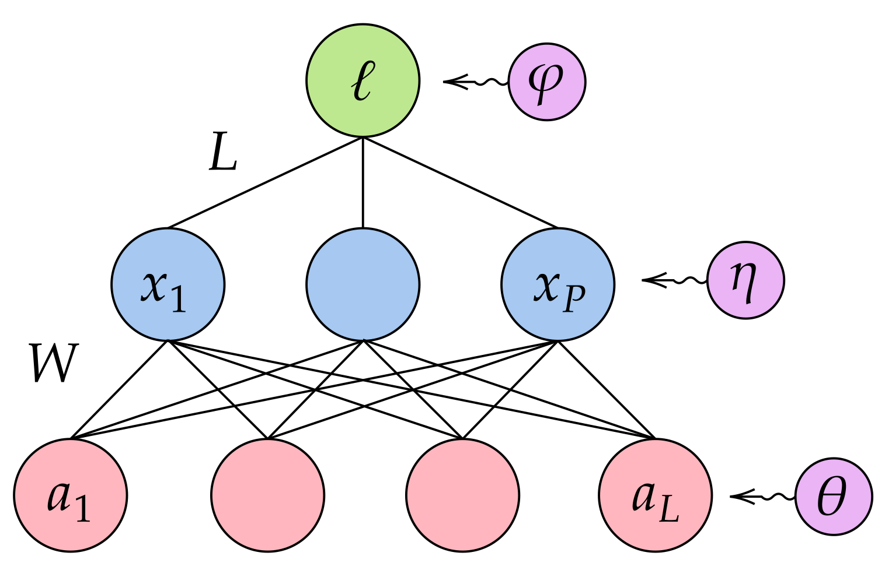

# ANNotation Assisted Direct Coupling Analysis (annaDCA)
This package contains the methods and scripts to train and sample an RBM model provided with data annotations.

<p align="center">
    
</p>

## ⬇️ Installation
The project is managed with [uv](https://docs.astral.sh/uv/).
### Option 1: from PyPI
Add the package to your uv project:
```bash
uv add annadca
```
or install it in the current environment with `uv pip install annadca` (or `python -m pip install annadca`).
### Option 2: cloning the repository
```bash
git clone https://github.com/rossetl/annaDCA.git
cd annaDCA
uv sync
```
`uv sync` creates the virtual environment `.venv` with the locked dependencies (`uv.lock`) and the development tools. The plotting helpers in `annadca.plot` need the `plot` extra: `uv sync --extra plot`. Commands are then run in the environment with `uv run`, e.g. `uv run annadca train -h`.

## 📘 Usage
After installation, the routines are launched through the command-line interface `annadca` (or `python -m annadca`):
- `annadca train`: trains a model;
- `annadca sample`: samples sequences from a trained model, optionally conditioned on a label.

To see all the options of a command, use
```bash
annadca train -h
annadca sample -h
```

### ✔️ Input data format

The training routine requires three types of information: the __training sequences__, their __identifiers__ and the assocated __annotations__.

The package supports both binary variables and categorical variables (e.g. amino acid sequences).

These input data can be provided to the routine in two different ways:

- By providing a `csv` file to the `-d` argument that contains identifiers, sequences and annotations. By default, the routine will check for the columns `name`, `sequence` and `label`, but the user can specify different names using the arguments `--column_names`, `--column_sequences` and `--column_labels`.

- By providing a `fasta` file (categorical variables) or a plain text file with extension `.txt` or `.dat` (binary variables) to the `-d` argument and an additional `csv` file to the `-a` argument containing the sequence identifiers and the annotations. Importantly, the sequence identifiers must match with those that are present in the `fasta` file. For plain text files, the identifier of each sequence is its row index (starting from 0).

To train the model with default arguments and a single csv file, use
```bash
annadca train -d <path_data> -o <output_directory> -l <model_tag>
```
The training stops if the outputs with the same tag already exist: use `--overwrite` to replace them, or `-p <checkpoint>` to resume the training from a checkpoint (the log file is then extended).

### 📈 Training outputs
In the output folder, the routine saves
- `<model_tag>.log`: the training options, and, every `--save_every` updates, the learning rate, the Pearson correlation between the connected two-point correlations of the data and of the chains, and the accuracy of the label prediction p(label | sequence) on the annotated sequences;
- `<model_tag>_checkpoints/model_update_<n>.pt`: self-describing checkpoints with the model configuration, the parameters, the chains (in compact form), the optimizer state, the alphabet and the label names;
- `<model_tag>_weights.dat`: the sequence weights.

A checkpoint is loaded with
```python
from annadca import load_rbm
rbm, checkpoint = load_rbm("<model_tag>_checkpoints/model_update_10000.pt")
chains, metadata = checkpoint["chains"], checkpoint["metadata"]
```

### 🎲 Sampling
```bash
annadca sample -p <checkpoint> -o samples.fasta -n 1000 --gibbs_steps 1000 --target <label>
```
The sequences are saved in fasta format, with the label in the header (`>chain_<i>|label=<label>`). Without `--target`, the labels are sampled jointly with the sequences.

#### Sequence data format
The model supports the following input data format:
- __Binary variables__ (use the `--is_binary` flag):
    - plain text format. Each row is one data sample, variables are separated by white spaces.
    - `csv` format: each sequence is a string of `0` and `1`.
- __Categorical variables__: 
    - [fasta](https://en.wikipedia.org/wiki/FASTA_format) format. Each data poin is a sequence of tokens with an header on top. The header row starts with `>`.
    - `csv` format: the file must contain one column with the aligned training sequences.

#### Annotations
By default, the annotations are treated as categorical: each distinct value of the label column is a class. Missing annotations are allowed (empty fields, or sequences absent from the annotation file). Duplicated sequences (or duplicated names in the annotation file) are merged: if they carry different labels, the label is set to missing (categorical labels) or to their mean (continuous labels). By default (`--missing_labels posterior`), the label of an unannotated sequence is summed over with its posterior p(label | sequence) computed by the model, which is the exact gradient of the likelihood of the unannotated sequences. With `--missing_labels zero`, the missing label is replaced by an all-zero label vector, which removes the coupling between the label and the hidden layer for that sequence. Use `--continuous_labels` to treat the annotations as real numbers: they are standardized and modeled with a Gaussian label layer.

### ⚙️ Model and training options
- `--potential`: type of hidden units, among `bernoulli`, `gaussian` and `relu`.
- By default, the gradient is __standardized__: the visible, hidden and label units are centered on their data mean, and the hidden and label units are rescaled by their standard deviation, in the parametrization used to compute the gradient. The parameters of the model are always stored in the original parametrization. Use `--no_standardize` to only center the units, or `--no_centering` to use the plain gradient.
- `--nupdates`: number of gradient updates; `--nchains`: number of persistent chains; `--batch_size`: number of data sequences per update (defaults to `--nchains`). All the sequences are used, in a new random order at each epoch.
- `--lr`: learning rate; `--lr_final`: if provided, the learning rate decays from `--lr` to `--lr_final` with a cosine schedule; `--max_grad_norm`: gradient clipping.
- `--pseudocount`: regularization of the statistics of the discrete variables (defaults to 1/Meff). The data statistics are mixed with the uniform distribution, consistently for the biases and the weights.
- `--l1`, `--l2`, `--l1l2`: regularization of the weight matrix; `--l1_label`, `--l2_label`: regularization of the label matrix.
- `--no_compile`: disable `torch.compile` for the sampling functions (useful for debugging, or when no compiler toolchain is available).

## 🐍 Python API
```python
from annadca import AnnaDataset, get_rbm

dataset = AnnaDataset("example_data/Natural_CM.csv", column_names="header")
rbm = get_rbm(
    visible_type="potts",          # 'potts', 'bernoulli', 'gaussian', 'relu'
    hidden_type="bernoulli",       # 'bernoulli', 'gaussian', 'relu'
    visible_shape=(dataset.L, dataset.q),
    hidden_shape=100,
    num_classes=dataset.get_num_classes(),
)
samples = rbm.sample(gibbs_steps=100, num_samples=1000)                    # visible, hidden and label chains
conditioned = rbm.sample_conditioned(gibbs_steps=100, targets=dataset.labels)
p_labels = rbm.predict_labels(dataset.data_one_hot)                        # p(label | visible)
```
Each layer of the model is a subclass of `annadca.layers.Layer`, so that new types of units can be added by implementing the abstract methods of this class (a subclass that defines `layer_type` is registered and can be saved and loaded in checkpoints).

## 🧪 Tests
```bash
uv run pytest
```
